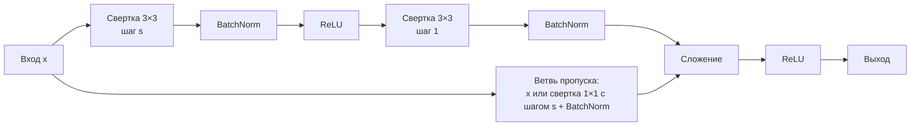
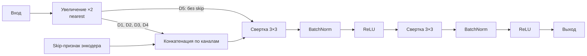

# Задача и модель

Задача: уменьшить размер и время работы модели сегментации кожных образований, сохранив качество масок. Для оценки использовал Dice, IoU, число параметров, GMACs, размер файла и время обработки одного изображения.

## Модель

Использовал `u-resnet34` из `segmentation-models-pytorch`: энкодер ResNet34 и декодер U-Net.

```python
smp.Unet("resnet34", encoder_weights="imagenet", classes=1, activation=None)
```

Энкодер инициализировал весами ImageNet. Для декодера и выходной свертки использовал случайную инициализацию.

Вход: RGB 256×256. Выход: один логит на пиксель. Маска получается после sigmoid с порогом 0,5. До прунинга: 24,44 млн параметров, 7,842 GMACs, файл 93,4 МБ.

## Энкодер и декодер

Энкодер: свертка 7×7 с шагом 2 → BatchNorm → ReLU → max-pooling → четыре стадии ResNet. Число остаточных блоков по стадиям: 3, 4, 6, 3. Разрешение уменьшается до 8×8, число каналов растет до 512.

Декодер: пять блоков с 256, 128, 64, 32 и 16 выходными каналами. Каждый увеличивает разрешение вдвое и выполняет две свертки 3×3 с BatchNorm и ReLU. Первые четыре блока получают skip-признаки энкодера через конкатенацию. Выходная свертка 3×3 переводит 16 каналов в один.

## Схема сети

Размеры: каналы × высота × ширина. Пунктир: skip-связи. R: остаточный блок; R↓: остаточный блок с уменьшением разрешения вдвое; D: блок декодера. Sigmoid и порог применяются после выхода сети.

```mermaid
%%{init: {"flowchart": {"useMaxWidth": false}}}%%
flowchart LR
    X["RGB<br/>3 × 256 × 256"]
    subgraph Encoder["Энкодер ResNet34"]
        C7["Свертка 7×7<br/>шаг 2, 3 → 64"]
        BN0["BatchNorm"]
        A0["ReLU<br/>64 × 128 × 128"]
        MP["Max-pooling 3×3<br/>шаг 2"]
        E1["Стадия 1: R × 3<br/>64 × 64 × 64"]
        E2["Стадия 2: R↓ + R × 3<br/>128 × 32 × 32"]
        E3["Стадия 3: R↓ + R × 5<br/>256 × 16 × 16"]
        E4["Стадия 4: R↓ + R × 2<br/>512 × 8 × 8"]
        C7 --> BN0 --> A0 --> MP --> E1 --> E2 --> E3 --> E4
    end
    subgraph Decoder["Декодер U-Net"]
        D1["D1<br/>256 × 16 × 16"]
        D2["D2<br/>128 × 32 × 32"]
        D3["D3<br/>64 × 64 × 64"]
        D4["D4<br/>32 × 128 × 128"]
        D5["D5<br/>16 × 256 × 256"]
        H["Свертка 3×3<br/>16 → 1"]
        Y["Логиты<br/>1 × 256 × 256"]
        D1 --> D2 --> D3 --> D4 --> D5 --> H --> Y
    end
    X --> C7
    E4 --> D1
    E3 -. "skip" .-> D1
    E2 -. "skip" .-> D2
    E1 -. "skip" .-> D3
    A0 -. "skip" .-> D4
    Y --> S["Sigmoid"]
    S --> M["Порог 0,5<br/>бинарная маска"]
```



### Остаточный блок R

Основная ветвь содержит две свертки. Перед последней ReLU результат складывается с ветвью пропуска.



R: шаг s = 1, число каналов сохраняется, ветвь пропуска передает x. R↓: шаг s = 2, число каналов удваивается; ветвь пропуска содержит свертку 1×1 с шагом 2 и BatchNorm. Вторая, третья и четвертая стадии начинаются с R↓.

### Блок декодера D



Число выходных каналов обеих сверток задается блоком D. Например, D1 соединяет 512 каналов входа с 256 каналами skip-признака: первая свертка преобразует 768 каналов в 256, вторая сохраняет 256.

Для прунинга использовал DependencyGraph Torch-Pruning: 30 групп, 5728 корневых каналов. Выходную голову исключил из прунинга.

## Обучение исходной сети

Обучил на MacBook M4 через MPS: 60 эпох; batch 16; AdamW; learning rate `3e-4`; weight decay `1e-4`; BCE + soft Dice loss; одна эпоха разогрева, затем cosine decay. По Dice val выбрал 60-ю эпоху.

Результат: Dice test 0,9244, IoU test 0,8677, Dice PH2 0,9112. Веса: `runs/models/base.pth`. Все варианты прунинга запускал из этого состояния.

```bash
.venv/bin/python src/train_base.py
```

Код: [common.py](../src/common.py), [train_base.py](../src/train_base.py). Параметры и метрики: [base_metrics.json](../runs/results/base_metrics.json).
