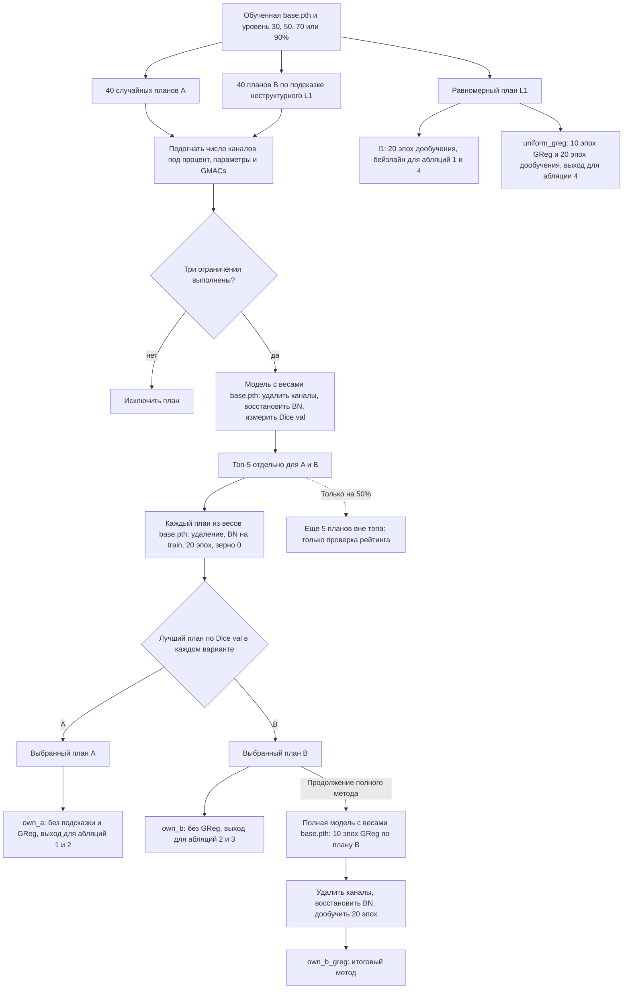

# Итоговый собственный метод

Метод состоит из поиска числа каналов в каждой группе и постепенного удаления выбранных каналов через GReg. Итоговая модель: `own_b_greg`. Остальные варианты сохранил для абляций.

План: 30 чисел, по одному на группу. Каждое число задает, сколько каналов в ней оставить. Внутри группы удаляются каналы с наименьшей L1-нормой весов. Порядок удаления определил один раз по обученной `base.pth`.

## Уровни прунинга

Для уровней 30, 50, 70 и 90% сравнивал план с равномерным прунингом того же уровня. План должен одновременно:

1. Удалить не менее указанного процента каналов.
2. Оставить не больше параметров, чем равномерный прунинг.
3. Дать не больше GMACs, чем равномерный прунинг.

| Уровень | Параметры равномерной модели, млн | GMACs | Минимум каналов в группе поиска |
|---|---:|---:|---:|
| 30% | 11,94 | 3,820 | 8 |
| 50% | 6,12 | 2,008 | 8 |
| 70% | 2,17 | 0,718 | 8 |
| 90% | 0,24 | 0,086 | 1 |

При минимуме 8 каналов даже самая маленькая допустимая модель требует около 0,164 GMACs. У равномерного прунинга 90% всего 0,086 GMACs, поэтому на этом уровне разрешил оставлять по одному каналу. Минимум 8 применяется только к поиску; равномерные бейзлайны такого ограничения не имеют.

## Генерация планов

Для каждого уровня создавал 40 планов A и 40 планов B.

A: для каждой группы случайно выбирал начальную долю сохраняемых каналов от 0,1 до 1.

B: взял `unstructured_l1_90.pth` и для каждой группы посчитал, какая доля весов осталась ненулевой. Из этой доли извлек квадратный корень. Например, если осталось 25% весов, получал `sqrt(0.25) = 0.5`.

Первый план B строил по этим значениям. Для остальных 39 умножал каждое значение на случайный коэффициент `exp(z)`. Число `z` выбирал из нормального распределения со средним 0 и стандартным отклонением 0,3.

Полученные значения переводил в число каналов. Сначала подгонял их под заданный процент удаления. Если параметров или операций оказывалось больше, чем у равномерной модели, дополнительно уменьшал число каналов. Поэтому фактическое удаление могло превышать название уровня.

## Отбор планов

Число каналов под заданный процент подбирал двоичным поиском: брал середину диапазона общего множителя для всех групп, после округления проверял сумму каналов и сужал диапазон в нужную сторону. Если параметры или GMACs превышали равномерный бейзлайн, вторым таким поиском уменьшал общее число сохраняемых каналов до выполнения ограничений.

1. Отбирал планы, которые проходят три ограничения.
2. Для каждого плана брал модель с весами `base.pth`, удалял указанные каналы и восстанавливал статистики BN на примерно 200 изображениях train без обучения. Затем измерял Dice val.
3. По пять лучших планов A и B дообучал независимо друг от друга. Каждое обучение начиналось с весов `base.pth`: удаление каналов по плану, восстановление BN на всем train, 20 эпох дообучения.
4. По Dice val выбирал лучший план A и лучший план B.

На уровне 50% дополнительно обучил пять планов вне топ-5, чтобы проверить, совпадает ли быстрый рейтинг с результатом после дообучения. Эти планы не участвовали в выборе победителей.

## Схема

У выходов указано, для каких сравнений сохранена модель. Итоговые варианты обучались с зернами 0, 1 и 2.

## Постепенное удаление через GReg

Для выбранного плана B использовал полную модель с исходными обученными весами `base.pth`. В течение 10 эпох обучал ее и после каждого шага умножал веса удаляемых каналов и связанные параметры BN на `1 - lambda`. Lambda росла до 0,05 за первые 70% шагов, затем оставалась постоянной. Learning rate: `1e-4`.

После этого физически удалял каналы, восстанавливал BN на train и дообучал сеть 20 эпох с learning rate `2e-4`. Лучшую эпоху выбирал по Dice val. Получал полный вариант `own_b_greg`.

Для `uniform_greg` те же действия выполнял по равномерному плану L1.

## Зерна и абляции

Поиск планов выполнял один раз на уровень с зерном обучения 0. Выбранные планы оставались одинаковыми для трех зерен: 0, 1, 2. Для A и B результат зерна 0 уже получен при отборе; с зернами 1 и 2 повторял дообучение из `base.pth`. Для вариантов с GReg с каждым зерном выполнял и 10 эпох гашения, и 20 эпох дообучения.

Каждый независимый запуск начинался с одинаковых обученных весов `base.pth`. При смене зерна менялись порядок обучающих изображений и аугментации.

| Абляция | Какие модели сравнивал | Что проверял |
|---|---|---|
| 1. Поиск распределения каналов | `l1` и `own_a` | Помогает ли неравномерный план вместо одинаковой доли удаления во всех группах |
| 2. Подсказка неструктурного прунинга | `own_a` и `own_b` | Что дает подсказка по сравнению со случайным поиском; учитывал и качество, и размер модели |
| 3. Постепенное удаление | `own_b` и `own_b_greg` | Что дает GReg при одном выбранном плане B |
| 4. GReg без поиска | `l1` и `uniform_greg` | Что дает GReg на равномерном плане |

Для основного сравнения повторил random, L1, FPGM, BN scale, Taylor и неструктурный L1 на всех четырех уровнях с зернами 0, 1, 2. Варианты с GReg получали дополнительные 10 эпох обучения.

На выбранных моделях измерял Dice и IoU на test, Dice на PH2, параметры, GMACs, файл и время работы. Качество сравнивал по среднему и стандартному отклонению трех зерен. Test и PH2 не использовал для выбора планов и эпох. Скорость измерял на моделях зерна 0.

Код: [own_method.py](../src/own_method.py), [удаление каналов, BN и GReg](../src/own_method_mini.py). Предварительная проверка: [мини-запуск](05_mini_experiment.md). Итоговые результаты: [полный эксперимент](06_full_experiment.md).
