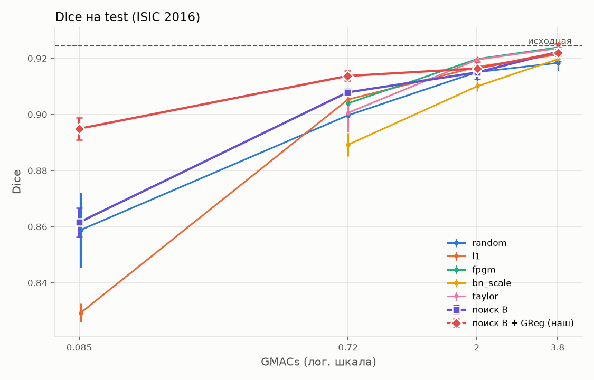
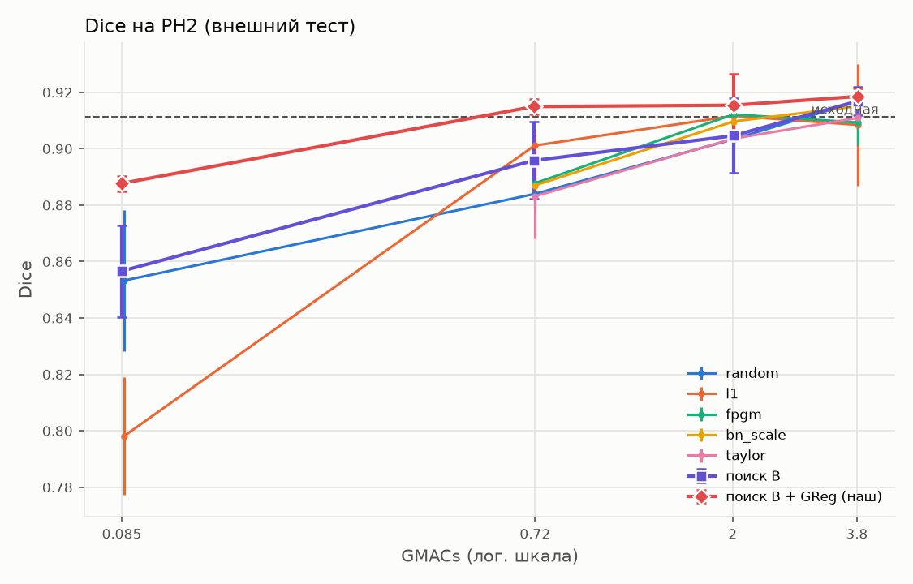

# Полный эксперимент

Обучение и оценку качества выполнил в Colab на CUDA, скорость измерил на MacBook M4. Сравнил шесть бейзлайнов: random, L1, FPGM, BN scale, Taylor и неструктурный L1. Собственный метод проверил в четырех вариантах: A, B, B + GReg и равномерный L1 + GReg. Для уровней 30, 50, 70 и 90% обучил каждый вариант с зернами 0, 1 и 2. Получил 120 итоговых моделей.

При поиске дообучил 45 планов. Восемь победителей вошли в итоговые 120 моделей, остальные 37 использовались только для отбора. Поиск выполнял один раз на уровень, затем повторял обучение выбранных планов с тремя зернами. Во всех вариантах использовал одну исходную обученную `base.pth`.

Дообучение: 20 эпох, AdamW, learning rate `2e-4`, batch 16, weight decay `1e-4`, cosine decay. Для GReg дополнительно выполнял 10 эпох с learning rate `1e-4`. Эпоху и план выбирал по Dice val; test и PH2 использовал для оценки качества.

У бейзлайнов дополнительно проверил качество до и после восстановления статистик BN без обучения. Само дообучение бейзлайнов оставил без предварительного восстановления BN. У вариантов собственного метода BN восстанавливался перед дообучением.

## Как представлены значения

- Dice и IoU: среднее по изображениям, затем среднее ± выборочное стандартное отклонение по трем зернам. В тексте приведены средние, в таблицах также указан разброс. Для исходной модели приведен один результат.
- Уровень 30, 50, 70 или 90%: условие сравнения с равномерным прунингом, а не среднее значение. Фактический процент удаленных каналов указан отдельно.
- Удалено каналов, параметры и GMACs: среднее по трем зернам. Во всех трех повторах эти числа совпали, поэтому их стандартное отклонение равно нулю. Параметры здесь означают их количество.
- Размер файла `.pth`: модель зерна 0.
- CPU и ORT: модель зерна 0, один поток, batch 1. Значение представляет медиану 100 измерений после 20 прогревов. Усреднения скорости по зернам нет. ORT означает ONNX Runtime.

У неструктурного L1 процент уровня относится к обнуленным весам. Каналы при этом сохраняются. В полном summary столбец «Веса» для этого метода показывает число ненулевых параметров, хотя общее количество хранимых весов не уменьшается.

## Качество сегментации

Ниже приведены все методы на уровне 70%. Исходная модель указана для сравнения. Все значения, кроме исходной модели, представлены как среднее ± стандартное отклонение по трем зернам.

| Метод | Dice test | IoU test | Dice PH2 |
|---|---|---|---|
| Исходная | 0,9244 | 0,8677 | 0,9112 |
| Random | 0,8997 ± 0,0044 | 0,8299 ± 0,0066 | 0,8840 ± 0,0026 |
| L1 | 0,9053 ± 0,0025 | 0,8391 ± 0,0040 | 0,9011 ± 0,0047 |
| FPGM | 0,9039 ± 0,0014 | 0,8373 ± 0,0020 | 0,8877 ± 0,0085 |
| BN scale | 0,8892 ± 0,0041 | 0,8162 ± 0,0064 | 0,8870 ± 0,0059 |
| Taylor | 0,9005 ± 0,0068 | 0,8320 ± 0,0100 | 0,8831 ± 0,0150 |
| Неструктурный L1 | 0,9247 ± 0,0029 | 0,8680 ± 0,0047 | 0,9162 ± 0,0054 |
| Поиск A | 0,9113 ± 0,0004 | 0,8482 ± 0,0008 | 0,9029 ± 0,0031 |
| Поиск B | 0,9078 ± 0,0013 | 0,8427 ± 0,0024 | 0,8958 ± 0,0136 |
| B + GReg | 0,9137 ± 0,0018 | 0,8517 ± 0,0023 | 0,9150 ± 0,0028 |
| Равномерный L1 + GReg | 0,9123 ± 0,0002 | 0,8505 ± 0,0008 | 0,9109 ± 0,0092 |

На 70% полный метод лучше структурных бейзлайнов без GReg, но близок к равномерному L1 + GReg. Неструктурный L1 лучше сохраняет качество, но почти не сокращает время работы и размер файла.

На 30 и 50% преимущества полного метода по Dice test не получено. На 90% он лучше random, L1 и равномерного L1 + GReg. FPGM, BN scale и Taylor на этом уровне не восстановили качество.

Восстановление BN возвращало часть качества без обучения, но при сильном удалении каналов помогало не всем методам.

Все уровни, метрики IoU и PH2, а также результаты проверки BN: [полная таблица](../runs/results/own/own_summary.md#1-все-методы).

## Размер и время

Сравнение L1 и полного метода на всех уровнях. Процент каналов, параметры и GMACs совпадают между зернами; файл и время относятся к зерну 0.

| Уровень | Метод | Удалено каналов | Параметры, млн | GMACs | Файл, МБ | CPU, мс | ORT, мс |
|---|---|---|---|---|---|---|---|
| 0% | Исходная | 0,0% | 24,44 | 7,842 | 93,36 | 47,4 | 20,2 |
| 30% | L1 | 30,2% | 11,94 | 3,820 | 45,67 | 31,8 | 13,9 |
| 30% | B + GReg | 49,8% | 5,45 | 3,812 | 20,93 | 36,1 | 15,2 |
| 50% | L1 | 50,0% | 6,12 | 2,008 | 23,46 | 22,1 | 9,1 |
| 50% | B + GReg | 66,5% | 2,03 | 2,006 | 7,85 | 26,2 | 11,1 |
| 70% | L1 | 70,3% | 2,17 | 0,718 | 8,40 | 12,9 | 6,2 |
| 70% | B + GReg | 80,6% | 0,624 | 0,715 | 2,48 | 15,8 | 6,8 |
| 90% | L1 | 90,3% | 0,239 | 0,086 | 1,01 | 5,2 | 2,4 |
| 90% | B + GReg | 93,6% | 0,077 | 0,085 | 0,39 | 5,8 | 4,0 |

При близком числе операций полный метод удаляет больше каналов и дает меньший файл, но работает медленнее L1 на CPU и ORT. По сравнению с исходной сетью он меньше и быстрее. Относительно равномерного прунинга выигрыш получен по размеру и качеству на сильных уровнях.

Размеры и время остальных методов: [полная таблица](../runs/results/own/own_summary.md#1-все-методы).

## Абляции

Проверил четыре сравнения:

1. A против L1: помогает ли поиск распределения каналов.
2. B против A: что дает подсказка неструктурного прунинга.
3. B + GReg против B: что дает постепенное удаление при одном плане B.
4. Равномерный L1 + GReg против L1: что дает GReg без поиска.

Dice test после дообучения, среднее ± стандартное отклонение по трем зернам:

| Уровень | L1 | A | B | B + GReg | L1 + GReg |
|---|---|---|---|---|---|
| 30% | 0,9214 ± 0,0046 | 0,9204 ± 0,0005 | 0,9223 ± 0,0015 | 0,9220 ± 0,0032 | 0,9230 ± 0,0012 |
| 50% | 0,9169 ± 0,0018 | 0,9189 ± 0,0017 | 0,9150 ± 0,0025 | 0,9164 ± 0,0025 | 0,9215 ± 0,0017 |
| 70% | 0,9053 ± 0,0025 | 0,9113 ± 0,0004 | 0,9078 ± 0,0013 | 0,9137 ± 0,0018 | 0,9123 ± 0,0002 |
| 90% | 0,8293 ± 0,0033 | 0,8703 ± 0,0075 | 0,8615 ± 0,0052 | 0,8949 ± 0,0039 | 0,8773 ± 0,0045 |

Различие считалось заметным, если модуль разницы средних превышал порог:

```text
delta = среднее второго варианта - среднее первого варианта
порог = 2 × sqrt(s1² / 3 + s2² / 3)
```

s1 и s2: стандартные отклонения по трем зернам. Положительная заметная разница: «лучше», отрицательная: «хуже». Разница не превышает порог: «разброс».

Разница средних Dice test:

| Уровень | A минус L1 | B минус A | B + GReg минус B | L1 + GReg минус L1 |
|---|---|---|---|---|
| 30% | -0,0010 (разброс) | +0,0019 (лучше) | -0,0003 (разброс) | +0,0016 (разброс) |
| 50% | +0,0020 (разброс) | -0,0039 (хуже) | +0,0014 (разброс) | +0,0046 (лучше) |
| 70% | +0,0061 (лучше) | -0,0035 (хуже) | +0,0059 (лучше) | +0,0071 (лучше) |
| 90% | +0,0410 (лучше) | -0,0088 (разброс) | +0,0334 (лучше) | +0,0481 (лучше) |

Поиск A улучшил Dice на 70 и 90%. Подсказка B на 50 и 70% снизила Dice относительно A, но дала меньшие модели. GReg улучшил B на 70 и 90%; на 30 и 50% заметного улучшения не было.

Равномерный L1 + GReg также улучшил обычный L1 на сильных уровнях. Полный метод относительно него на 70% не показал заметного выигрыша по Dice, на 90% оказался лучше.

Полные сравнения с каждым бейзлайном и абляции: [summary](../runs/results/own/own_summary.md#3-абляция-dice-test-после-дообучения).

## Графики

По горизонтали: GMACs, по вертикали: Dice. Левее и выше означает меньше операций и лучшее качество. Точки: среднее по трем зернам, вертикальные отрезки: стандартное отклонение, пунктир: исходная модель. Уровни слева направо: 90, 70, 50, 30%.



На ISIC test преимущество полного метода проявилось при сильном сжатии. На 30 и 50% выигрыша над лучшими бейзлайнами нет. На 70 и 90% качество выше, чем у показанных структурных бейзлайнов, а прирост от GReg заметнее. На 90% разброс random шире, чем у полного метода.



На PH2 полный метод также лучше сохраняет качество при сильном сжатии. На 70% результат близок к исходной модели. На 90% качество снижается, но остается выше random и L1. На 50% между зернами заметен разброс.

На графиках показаны пять структурных бейзлайнов, B и B + GReg. A и равномерный L1 + GReg представлены в таблице абляций. Неструктурный L1 не показан, поскольку его GMACs не меняются; точки FPGM, BN scale и Taylor 90% с Dice около нуля также исключены.

## Быстрая оценка планов

Сравнил рейтинг по Dice val после восстановления BN с рейтингом после дообучения. Корреляция Спирмена составила -0,891 / 0,361 / 0,503 / 0,479 на уровнях 30 / 50 / 70 / 90%. Это результаты одного поиска на уровень, не средние по трем зернам. Корреляция рассчитана по 10 дообученным планам на каждом уровне, кроме 50%, где проверены 15.

Быстрый рейтинг оказался ненадежным: лучший план по нему ни разу не стал лучшим после дообучения.

Подробные результаты BN, удаления после GReg и рейтинга планов: [полный отчет](../runs/results/own/own_summary.md). Исходные числа: [качество](../runs/results/own/own_results.csv), [размер и время](../runs/results/own/own_benchmark.csv).
