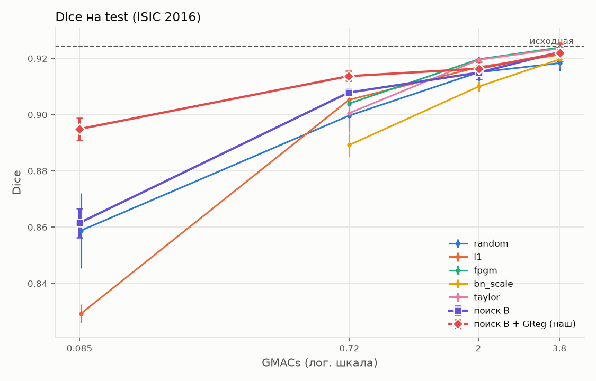
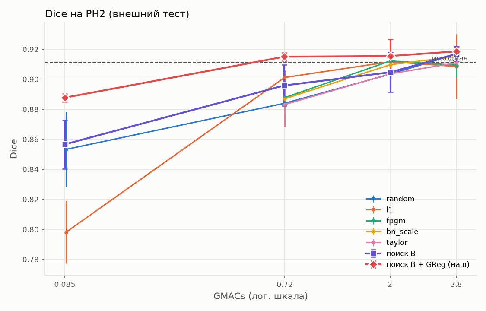

# Свой метод: результаты

ISIC 2016 test (379) и PH2 (200), 256x256. Обучение на cuda, зерна [0, 1, 2]; Dice — среднее ± ст. откл. по зернам. Выбор кандидатов и победителей только по val. Время — медиана, batch 1, модели зерна 0, замер локально.

## 1. Все методы

Стадии: «после прунинга» — сразу после удаления каналов (у GReg — после гашения и удаления); «+ пересчет BN» — то же после пересчета статистик BN (у бейзлайна на копии, дообучение идет без него); «после дообучения» — итог. У unstructured_l1 веса — ненулевые, GMACs не меняются.

| Уровень | Метод | Зерен | Удалено каналов | Веса, M | GMACs | Dice test после прунинга | + пересчет BN | Dice test после дообучения | IoU test | Dice PH2 | Файл, МБ | CPU 1п, мс | ORT 1п, мс |
|---|---|---|---|---|---|---|---|---|---|---|---|---|---|
| 0% | исходная | — | 0% | 24.44 | 7.84 | — | — | 0.9244 | 0.8677 | 0.9112 | 93.4 | 47.4 | 20.2 |
| 30% | random | 3 | 30.2% | 11.94 | 3.820 | 0.0001 ± 0.0002 | 0.8274 ± 0.0377 | 0.9184 ± 0.0027 | 0.8586 ± 0.0030 | 0.9168 ± 0.0051 | 45.7 | 31.8 | 13.8 |
| 30% | l1 | 3 | 30.2% | 11.94 | 3.820 | 0.3037 ± 0.0000 | 0.8519 ± 0.0000 | 0.9214 ± 0.0046 | 0.8632 ± 0.0060 | 0.9085 ± 0.0216 | 45.7 | 31.8 | 13.9 |
| 30% | fpgm | 3 | 30.2% | 11.94 | 3.820 | 0.0000 ± 0.0000 | 0.8852 ± 0.0000 | 0.9239 ± 0.0009 | 0.8669 ± 0.0012 | 0.9093 ± 0.0079 | 45.7 | 31.9 | 13.9 |
| 30% | bn_scale | 3 | 30.2% | 11.94 | 3.820 | 0.0000 ± 0.0000 | 0.7576 ± 0.0000 | 0.9197 ± 0.0005 | 0.8609 ± 0.0007 | 0.9151 ± 0.0016 | 45.7 | 31.9 | 14.0 |
| 30% | taylor | 3 | 30.2% | 11.94 | 3.820 | 0.4095 ± 0.4047 | 0.8555 ± 0.0188 | 0.9236 ± 0.0013 | 0.8666 ± 0.0015 | 0.9109 ± 0.0032 | 45.7 | 31.8 | 14.0 |
| 30% | unstructured_l1 | 3 | 0.0% | 17.11 | 7.842 | 0.9247 ± 0.0000 | 0.9230 ± 0.0000 | 0.9233 ± 0.0010 | 0.8662 ± 0.0016 | 0.9174 ± 0.0098 | 93.4 | 47.4 | 20.6 |
| 30% | поиск A | 3 | 30.0% | 9.51 | 3.722 | 0.0331 ± 0.0000 | 0.8645 ± 0.0000 | 0.9204 ± 0.0005 | 0.8619 ± 0.0003 | 0.9223 ± 0.0024 | 36.4 | 33.2 | 13.9 |
| 30% | поиск B | 3 | 49.8% | 5.45 | 3.812 | 0.4904 ± 0.0000 | 0.8861 ± 0.0000 | 0.9223 ± 0.0015 | 0.8639 ± 0.0014 | 0.9169 ± 0.0051 | 20.9 | 36.1 | 15.2 |
| 30% | **поиск B + GReg (наш)** | 3 | 49.8% | 5.45 | 3.812 | 0.9217 ± 0.0018 | 0.9205 ± 0.0016 | 0.9220 ± 0.0032 | 0.8634 ± 0.0045 | 0.9185 ± 0.0027 | 20.9 | 36.1 | 15.2 |
| 30% | равномерный + GReg | 3 | 30.2% | 11.94 | 3.820 | 0.9191 ± 0.0021 | 0.9195 ± 0.0018 | 0.9230 ± 0.0012 | 0.8653 ± 0.0021 | 0.9122 ± 0.0078 | 45.7 | 31.7 | 13.9 |
| 50% | random | 3 | 50.0% | 6.12 | 2.008 | 0.0001 ± 0.0001 | 0.6677 ± 0.0742 | 0.9151 ± 0.0032 | 0.8534 ± 0.0061 | 0.9034 ± 0.0037 | 23.5 | 22.0 | 9.1 |
| 50% | l1 | 3 | 50.0% | 6.12 | 2.008 | 0.0000 ± 0.0000 | 0.7349 ± 0.0000 | 0.9169 ± 0.0018 | 0.8577 ± 0.0029 | 0.9117 ± 0.0087 | 23.5 | 22.1 | 9.1 |
| 50% | fpgm | 3 | 50.0% | 6.12 | 2.008 | 0.0000 ± 0.0000 | 0.7401 ± 0.0000 | 0.9197 ± 0.0010 | 0.8597 ± 0.0018 | 0.9122 ± 0.0068 | 23.5 | 21.8 | 9.0 |
| 50% | bn_scale | 3 | 50.0% | 6.12 | 2.008 | 0.0000 ± 0.0000 | 0.5909 ± 0.0000 | 0.9100 ± 0.0018 | 0.8471 ± 0.0027 | 0.9097 ± 0.0023 | 23.5 | 21.9 | 9.1 |
| 50% | taylor | 3 | 50.0% | 6.12 | 2.008 | 0.2467 ± 0.4274 | 0.4705 ± 0.0392 | 0.9195 ± 0.0007 | 0.8601 ± 0.0011 | 0.9036 ± 0.0033 | 23.5 | 22.1 | 9.1 |
| 50% | unstructured_l1 | 3 | 0.0% | 12.23 | 7.842 | 0.9230 ± 0.0000 | 0.9233 ± 0.0000 | 0.9219 ± 0.0021 | 0.8643 ± 0.0028 | 0.9154 ± 0.0061 | 93.4 | 47.4 | 20.6 |
| 50% | поиск A | 3 | 50.0% | 5.89 | 2.005 | 0.0000 ± 0.0000 | 0.7129 ± 0.0000 | 0.9189 ± 0.0017 | 0.8593 ± 0.0018 | 0.9164 ± 0.0053 | 22.6 | 23.8 | 10.3 |
| 50% | поиск B | 3 | 66.5% | 2.03 | 2.006 | 0.0000 ± 0.0000 | 0.7769 ± 0.0000 | 0.9150 ± 0.0025 | 0.8557 ± 0.0030 | 0.9046 ± 0.0132 | 7.9 | 26.2 | 10.9 |
| 50% | **поиск B + GReg (наш)** | 3 | 66.5% | 2.03 | 2.006 | 0.9108 ± 0.0042 | 0.9111 ± 0.0012 | 0.9164 ± 0.0025 | 0.8576 ± 0.0030 | 0.9154 ± 0.0110 | 7.9 | 26.2 | 11.1 |
| 50% | равномерный + GReg | 3 | 50.0% | 6.12 | 2.008 | 0.9149 ± 0.0035 | 0.9153 ± 0.0028 | 0.9215 ± 0.0017 | 0.8630 ± 0.0031 | 0.9213 ± 0.0024 | 23.5 | 22.1 | 9.1 |
| 70% | random | 3 | 70.3% | 2.17 | 0.718 | 0.1330 ± 0.2304 | 0.3367 ± 0.0701 | 0.8997 ± 0.0044 | 0.8299 ± 0.0066 | 0.8840 ± 0.0026 | 8.4 | 13.0 | 6.2 |
| 70% | l1 | 3 | 70.3% | 2.17 | 0.718 | 0.0000 ± 0.0000 | 0.4161 ± 0.0000 | 0.9053 ± 0.0025 | 0.8391 ± 0.0040 | 0.9011 ± 0.0047 | 8.4 | 12.9 | 6.2 |
| 70% | fpgm | 3 | 70.3% | 2.17 | 0.718 | 0.0000 ± 0.0000 | 0.0000 ± 0.0000 | 0.9039 ± 0.0014 | 0.8373 ± 0.0020 | 0.8877 ± 0.0085 | 8.4 | 12.8 | 6.2 |
| 70% | bn_scale | 3 | 70.3% | 2.17 | 0.718 | 0.0000 ± 0.0000 | 0.0000 ± 0.0000 | 0.8892 ± 0.0041 | 0.8162 ± 0.0064 | 0.8870 ± 0.0059 | 8.4 | 12.8 | 6.1 |
| 70% | taylor | 3 | 70.3% | 2.17 | 0.718 | 0.0000 ± 0.0000 | 0.0719 ± 0.1246 | 0.9005 ± 0.0068 | 0.8320 ± 0.0100 | 0.8831 ± 0.0150 | 8.4 | 12.6 | 6.1 |
| 70% | unstructured_l1 | 3 | 0.0% | 7.34 | 7.842 | 0.9145 ± 0.0000 | 0.9239 ± 0.0000 | 0.9247 ± 0.0029 | 0.8680 ± 0.0047 | 0.9162 ± 0.0054 | 93.4 | 47.6 | 20.5 |
| 70% | поиск A | 3 | 74.1% | 1.69 | 0.718 | 0.0000 ± 0.0000 | 0.5129 ± 0.0000 | 0.9113 ± 0.0004 | 0.8482 ± 0.0008 | 0.9029 ± 0.0031 | 6.6 | 14.3 | 6.5 |
| 70% | поиск B | 3 | 80.6% | 0.62 | 0.715 | 0.0000 ± 0.0000 | 0.5430 ± 0.0000 | 0.9078 ± 0.0013 | 0.8427 ± 0.0024 | 0.8958 ± 0.0136 | 2.5 | 15.9 | 6.7 |
| 70% | **поиск B + GReg (наш)** | 3 | 80.6% | 0.62 | 0.715 | 0.9025 ± 0.0013 | 0.9045 ± 0.0021 | 0.9137 ± 0.0018 | 0.8517 ± 0.0023 | 0.9150 ± 0.0028 | 2.5 | 15.8 | 6.8 |
| 70% | равномерный + GReg | 3 | 70.3% | 2.17 | 0.718 | 0.8913 ± 0.0057 | 0.8951 ± 0.0037 | 0.9123 ± 0.0002 | 0.8505 ± 0.0008 | 0.9109 ± 0.0092 | 8.4 | 12.8 | 6.1 |
| 90% | random | 3 | 90.3% | 0.24 | 0.086 | 0.1344 ± 0.2328 | 0.2020 ± 0.0728 | 0.8588 ± 0.0134 | 0.7733 ± 0.0170 | 0.8533 ± 0.0249 | 1.0 | 5.3 | 2.4 |
| 90% | l1 | 3 | 90.3% | 0.24 | 0.086 | 0.0000 ± 0.0000 | 0.0000 ± 0.0000 | 0.8293 ± 0.0033 | 0.7384 ± 0.0028 | 0.7981 ± 0.0209 | 1.0 | 5.2 | 2.4 |
| 90% | fpgm | 3 | 90.3% | 0.24 | 0.086 | 0.0000 ± 0.0000 | 0.0000 ± 0.0000 | 0.0000 ± 0.0000 | 0.0000 ± 0.0000 | 0.0000 ± 0.0000 | 1.0 | 5.0 | 2.4 |
| 90% | bn_scale | 3 | 90.3% | 0.24 | 0.086 | 0.0000 ± 0.0000 | 0.0002 ± 0.0000 | 0.0000 ± 0.0000 | 0.0000 ± 0.0000 | 0.0000 ± 0.0000 | 1.0 | 5.2 | 2.4 |
| 90% | taylor | 3 | 90.3% | 0.24 | 0.086 | 0.0000 ± 0.0000 | 0.0001 ± 0.0001 | 0.0000 ± 0.0000 | 0.0000 ± 0.0000 | 0.0000 ± 0.0000 | 1.0 | 5.1 | 2.4 |
| 90% | unstructured_l1 | 3 | 0.0% | 2.46 | 7.842 | 0.8498 ± 0.0000 | 0.9084 ± 0.0000 | 0.9249 ± 0.0008 | 0.8690 ± 0.0013 | 0.9171 ± 0.0069 | 93.4 | 46.6 | 20.1 |
| 90% | поиск A | 3 | 90.6% | 0.16 | 0.084 | 0.0000 ± 0.0000 | 0.3956 ± 0.0000 | 0.8703 ± 0.0075 | 0.7893 ± 0.0092 | 0.8612 ± 0.0114 | 0.7 | 5.5 | 3.6 |
| 90% | поиск B | 3 | 93.6% | 0.08 | 0.085 | 0.0000 ± 0.0000 | 0.3245 ± 0.0000 | 0.8615 ± 0.0052 | 0.7774 ± 0.0069 | 0.8566 ± 0.0163 | 0.4 | 5.9 | 4.0 |
| 90% | **поиск B + GReg (наш)** | 3 | 93.6% | 0.08 | 0.085 | 0.8629 ± 0.0088 | 0.8675 ± 0.0022 | 0.8949 ± 0.0039 | 0.8232 ± 0.0062 | 0.8877 ± 0.0028 | 0.4 | 5.8 | 4.0 |
| 90% | равномерный + GReg | 3 | 90.3% | 0.24 | 0.086 | 0.0000 ± 0.0000 | 0.0000 ± 0.0000 | 0.8773 ± 0.0045 | 0.7983 ± 0.0068 | 0.8221 ± 0.0138 | 1.0 | 5.1 | 2.4 |

## 2. Поиск B + GReg против каждого метода бейзлайна

Разница средних Dice после дообучения (наш минус метод). «Заметно» — больше двух стандартных ошибок.

| Уровень | Метод | Δ Dice test | Δ Dice PH2 | Δ CPU 1п, мс |
|---|---|---|---|---|
| 30% | random | +0.0037 (в пределах шума) | +0.0017 (в пределах шума) | +4.3 |
| 30% | l1 | +0.0007 (в пределах шума) | +0.0101 (в пределах шума) | +4.3 |
| 30% | fpgm | -0.0019 (в пределах шума) | +0.0092 (в пределах шума) | +4.2 |
| 30% | bn_scale | +0.0023 (в пределах шума) | +0.0034 (в пределах шума) | +4.2 |
| 30% | taylor | -0.0015 (в пределах шума) | +0.0076 (заметно) | +4.3 |
| 30% | unstructured_l1 | -0.0013 (в пределах шума) | +0.0011 (в пределах шума) | -11.3 |
| 50% | random | +0.0013 (в пределах шума) | +0.0121 (в пределах шума) | +4.2 |
| 50% | l1 | -0.0006 (в пределах шума) | +0.0038 (в пределах шума) | +4.1 |
| 50% | fpgm | -0.0034 (заметно) | +0.0033 (в пределах шума) | +4.4 |
| 50% | bn_scale | +0.0063 (заметно) | +0.0058 (в пределах шума) | +4.3 |
| 50% | taylor | -0.0031 (заметно) | +0.0118 (в пределах шума) | +4.1 |
| 50% | unstructured_l1 | -0.0055 (заметно) | +0.0001 (в пределах шума) | -21.2 |
| 70% | random | +0.0140 (заметно) | +0.0310 (заметно) | +2.8 |
| 70% | l1 | +0.0084 (заметно) | +0.0138 (заметно) | +2.9 |
| 70% | fpgm | +0.0098 (заметно) | +0.0272 (заметно) | +2.9 |
| 70% | bn_scale | +0.0245 (заметно) | +0.0280 (заметно) | +3.0 |
| 70% | taylor | +0.0132 (заметно) | +0.0319 (заметно) | +3.1 |
| 70% | unstructured_l1 | -0.0110 (заметно) | -0.0012 (в пределах шума) | -31.8 |
| 90% | random | +0.0361 (заметно) | +0.0344 (заметно) | +0.6 |
| 90% | l1 | +0.0656 (заметно) | +0.0896 (заметно) | +0.6 |
| 90% | fpgm | +0.8949 (заметно) | +0.8877 (заметно) | +0.8 |
| 90% | bn_scale | +0.8949 (заметно) | +0.8877 (заметно) | +0.7 |
| 90% | taylor | +0.8949 (заметно) | +0.8877 (заметно) | +0.7 |
| 90% | unstructured_l1 | -0.0300 (заметно) | -0.0294 (заметно) | -40.8 |

## 3. Абляция (Dice test после дообучения)

| Уровень | равномерный (l1) | равномерный + GReg | поиск A | поиск B | поиск B + GReg |
|---|---|---|---|---|---|
| 30% | 0.9214 ± 0.0046 | 0.9230 ± 0.0012 | 0.9204 ± 0.0005 | 0.9223 ± 0.0015 | 0.9220 ± 0.0032 |
| 50% | 0.9169 ± 0.0018 | 0.9215 ± 0.0017 | 0.9189 ± 0.0017 | 0.9150 ± 0.0025 | 0.9164 ± 0.0025 |
| 70% | 0.9053 ± 0.0025 | 0.9123 ± 0.0002 | 0.9113 ± 0.0004 | 0.9078 ± 0.0013 | 0.9137 ± 0.0018 |
| 90% | 0.8293 ± 0.0033 | 0.8773 ± 0.0045 | 0.8703 ± 0.0075 | 0.8615 ± 0.0052 | 0.8949 ± 0.0039 |

| Уровень | 1. неравномерность (A − равномерный) | 2. подсказка (B − A) | 3. GReg с поиском (B+GReg − B) | 4. GReg без поиска (равн.+GReg − равн.) |
|---|---|---|---|---|
| 30% | -0.0010 (в пределах шума) | +0.0019 (заметно) | -0.0003 (в пределах шума) | +0.0016 (в пределах шума) |
| 50% | +0.0020 (в пределах шума) | -0.0039 (заметно) | +0.0014 (в пределах шума) | +0.0046 (заметно) |
| 70% | +0.0061 (заметно) | -0.0035 (заметно) | +0.0059 (заметно) | +0.0071 (заметно) |
| 90% | +0.0410 (заметно) | -0.0088 (в пределах шума) | +0.0334 (заметно) | +0.0481 (заметно) |

## 4. Порядок кандидатов: быстрый Dice (пересчет BN) против Dice после дообучения (val)

| Уровень | Кандидатов дообучено | Спирмен | Лучший по быстрому = лучший после дообучения | Победитель B: Dice val | Лучший из всех дообученных |
|---|---|---|---|---|---|
| 30% | 10 | -0.891 | нет | 0.9307 | 0.9330 |
| 50% | 15 | 0.361 | нет | 0.9324 | 0.9324 |
| 70% | 10 | 0.503 | нет | 0.9192 | 0.9228 |
| 90% | 10 | 0.479 | нет | 0.8759 | 0.8759 |

## 5. GReg: Dice val до и после удаления каналов (среднее по зернам)

| Уровень | Метод | до удаления | сразу после удаления | + пересчет BN | без GReg: после удаления + BN |
|---|---|---|---|---|---|
| 30% | own_b_greg | 0.9225 | 0.9225 | 0.9209 | 0.8893 (own_b) |
| 30% | uniform_greg | 0.9245 | 0.9245 | 0.9234 | 0.8410 (l1) |
| 50% | own_b_greg | 0.9228 | 0.9228 | 0.9213 | 0.7856 (own_b) |
| 50% | uniform_greg | 0.9207 | 0.9207 | 0.9210 | 0.7213 (l1) |
| 70% | own_b_greg | 0.9123 | 0.9122 | 0.9138 | 0.5360 (own_b) |
| 70% | uniform_greg | 0.8969 | 0.8965 | 0.8997 | 0.4029 (l1) |
| 90% | own_b_greg | 0.8570 | 0.8569 | 0.8651 | 0.3181 (own_b) |
| 90% | uniform_greg | 0.0000 | 0.0000 | 0.0000 | 0.0000 (l1) |

## 6. Графики

Точка — среднее по зернам, планка — ст. откл. unstructured_l1 не показан: GMACs у него не меняются.

Не показаны (средний Dice < 0,5): fpgm 90%, bn_scale 90%, taylor 90%.

Не показаны (средний Dice < 0,5): fpgm 90%, bn_scale 90%, taylor 90%.
